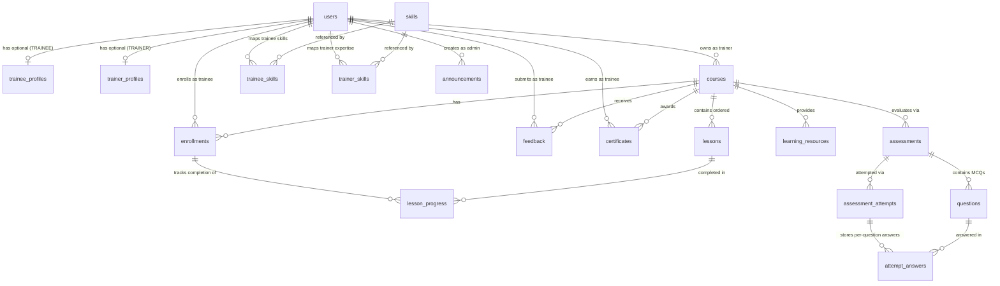

# CAPSERA — Conceptual Data Model (`DATA_MODEL.md`)

- **Status:** Baseline Conventions & Relationships Established / Column Schemas Pending Team Specification
- **Source of Truth:** [CAPSERA PRD v1.0](./PRD.md) (Sections 8.3, 9.1, 10, and 12) + [docs/DECISIONS.md](./DECISIONS.md) (`ADR-002`: PostgreSQL migration required by faculty, pending formal team approval)
- **Database Engine:** PostgreSQL 15+ (replacing MySQL 8+ / InnoDB per `ADR-002`)
- **Database Name:** `capsera_db`

> **Important:** This document captures only the canonical entity names, table names, relationships, and integrity rules mandated by PRD v1.0. Exact column definitions, data types, and migration files are **UNRESOLVED** and must be finalized by the respective module owners before writing SQL migrations in `database/migrations/`.

---

## 1. Database Conventions (Established by PRD & ADR-002)

1. **RDBMS Engine:** PostgreSQL (encoding `UTF8`) with full ACID transactions and foreign key enforcement.
2. **Database Name:** `capsera_db`.
3. **Naming Rules:**
   - **Table names:** Plural `snake_case` (e.g., `users`, `assessment_attempts`).
   - **Column names:** `snake_case` (e.g., `course_id`, `created_at`).
   - **Enum/status values:** Uppercase strings (e.g., `'PENDING'`, `'PUBLISHED'`), enforced via `CHECK` constraints or PostgreSQL `ENUM` types.
4. **Primary Keys:** Database-generated identity columns (`BIGINT GENERATED ALWAYS AS IDENTITY PRIMARY KEY` or `SERIAL`/`BIGSERIAL` — see `OPEN-DM-07`).
5. **Timestamps:** Persisted consistently in UTC using `TIMESTAMPTZ NOT NULL DEFAULT CURRENT_TIMESTAMP`, serialized to ISO 8601 strings in API responses.
6. **Deletion Policy:** Prefer status/archive columns (`ARCHIVED`, `SUSPENDED`, etc.) over hard `DELETE` wherever historical enrollments, assessment attempts, or certificates reference the record.
7. **Transactions:** Mandatory for multi-table writes during assessment submission/scoring and certificate issuance (via `withTransaction` in `server/src/config/db.js`).

---

## 2. Canonical Entities & Table Registry (PRD Section 10.4)

| Canonical Domain Entity | SQL Table Name (`snake_case` plural) | Primary Module Owner | Schema Status |
|---|---|---|---|
| `User` | `users` | Member 1 | **UNRESOLVED** (Columns pending) |
| `TraineeProfile` | `trainee_profiles` | Member 1 | **UNRESOLVED** (Columns pending) |
| `TrainerProfile` | `trainer_profiles` | Member 1 | **UNRESOLVED** (Columns pending) |
| `Skill` | `skills` | Member 4 | **UNRESOLVED** (Columns pending) |
| `TraineeSkill` | `trainee_skills` | Member 4 | **UNRESOLVED** (Columns pending) |
| `TrainerSkill` | `trainer_skills` | Member 4 | **UNRESOLVED** (Columns pending) |
| `Course` | `courses` | Member 2 | **UNRESOLVED** (Columns pending) |
| `Lesson` | `lessons` | Member 2 | **UNRESOLVED** (Columns pending) |
| `LearningResource` | `learning_resources` | Member 2 | **UNRESOLVED** (Columns pending) |
| `Enrollment` | `enrollments` | Member 2 | **UNRESOLVED** (Columns pending) |
| `LessonProgress` | `lesson_progress` | Member 2 | **UNRESOLVED** (Columns pending) |
| `Assessment` | `assessments` | Member 3 | **UNRESOLVED** (Columns pending) |
| `Question` | `questions` | Member 3 | **UNRESOLVED** (Columns pending) |
| `AssessmentAttempt` | `assessment_attempts` | Member 3 | **UNRESOLVED** (Columns pending) |
| `AttemptAnswer` | `attempt_answers` | Member 3 | **UNRESOLVED** (Columns pending) |
| `Feedback` | `feedback` (or `feedbacks` — see `OPEN-DM-01`) | Member 3 | **UNRESOLVED** (Columns pending) |
| `Certificate` | `certificates` | Member 4 | **UNRESOLVED** (Columns pending) |
| `Announcement` | `announcements` | Member 4 | **UNRESOLVED** (Columns pending) |

---

## 3. Established Relationships (PRD Section 12)

---

## 4. Mandatory Integrity Constraints (PRD Section 12)

Every PostgreSQL migration created by the team must enforce the following constraints at the database level:

1. **`users`:**
   - `UNIQUE (email)`
   - Role constrained to `'TRAINEE'`, `'TRAINER'`, `'ADMIN'`
   - Status constrained to `'PENDING'`, `'ACTIVE'`, `'REJECTED'`, `'SUSPENDED'` (default `'PENDING'`)
2. **`skills`:**
   - `UNIQUE (name)`
3. **`trainee_skills` & `trainer_skills`:**
   - Prevent duplicate skill mapping per user: `UNIQUE (trainee_id, skill_id)` and `UNIQUE (trainer_id, skill_id)` (column naming to be confirmed in `OPEN-DM-02`).
4. **`enrollments`:**
   - `UNIQUE (trainee_id, course_id)`
   - Status constrained to `'ACTIVE'`, `'COMPLETED'`, `'CANCELLED'`
5. **`lesson_progress`:**
   - Unique completion record per enrollment and lesson: `UNIQUE (enrollment_id, lesson_id)`
6. **`assessment_attempts`:**
   - `UNIQUE (assessment_id, trainee_id, attempt_number)`
   - Status constrained to `'IN_PROGRESS'`, `'SUBMITTED'`, `'GRADED'`, `'EXPIRED'`
7. **`feedback`:**
   - One current feedback record per trainee and course: `UNIQUE (trainee_id, course_id)`
   - Rating constrained to integer `1` through `5` (`CHECK (rating BETWEEN 1 AND 5)`)
8. **`certificates`:**
   - `UNIQUE (trainee_id, course_id)`
   - `UNIQUE (certificate_code)`
9. **Indexes:**
   - Foreign key columns (PostgreSQL does not auto-index foreign key columns, so explicit `CREATE INDEX` statements are required), `users(email)`, `users(role, status)`, `courses(status, subject)`, enrollment lookups, attempt history, and announcement publication/expiry filters.

---

## 5. Unresolved Schema Decisions (Pending Team Alignment)

The following items must be resolved before writing table creation DDL in `database/migrations/`:

- **`OPEN-DM-01` — Table name for `Feedback`:** PRD Section 12 refers to the table as `feedback` while Section 10.2 specifies plural `snake_case` table names. Member 3 and the team must confirm whether the SQL table name is `feedback` or `feedbacks`.
- **`OPEN-DM-02` — Foreign key column names to `users.id`:** Confirm whether role-specific foreign keys use `user_id` (e.g., in `trainee_profiles`, `trainer_profiles`) and `trainee_id` / `trainer_id` / `created_by_admin_id` in domain tables (`courses`, `enrollments`, `trainee_skills`, `trainer_skills`, `announcements`).
- **`OPEN-DM-03` — Skill Proficiency Scale:** PRD Section 6.8 requires ranking trainers by *"Higher declared proficiency"* and *"More relevant experience"*. Member 4 and Member 1 must agree on the canonical proficiency values (e.g., `BEGINNER`, `INTERMEDIATE`, `ADVANCED`, `EXPERT` with deterministic numeric weights).
- **`OPEN-DM-04` — Certificate Status Model:** Per PRD Section 10.3, choose between (`issued_at` + nullable `revoked_at`) OR an explicit `status` column (`ISSUED` / `REVOKED`).
- **`OPEN-DM-05` — Course Required Assessment Rule:** PRD Section 6.6 states *"if the course has a required published assessment, the trainee has passed it."* Member 2 and Member 3 must agree whether a course has at most one required assessment or an `is_required` boolean on `assessments`.
- **`OPEN-DM-06` — Audit Log Table:** PRD Section 8.1 requires recording audit events for admin approval, role changes, suspension, and certificate issuance. Team to confirm whether to add a shared `audit_logs` table and its columns.
- **`OPEN-DM-07` — PostgreSQL Primary Key & Enum Strategy:** Confirm whether all tables use `BIGINT GENERATED ALWAYS AS IDENTITY` vs `SERIAL` for primary keys, and `TEXT` + `CHECK (...)` constraints vs custom PostgreSQL `CREATE TYPE ... AS ENUM` for status/role columns.
