# CAPSERA — Relational Data Model (`DATA_MODEL.md`)

- **Status:** CP-02 Complete Proposed Schema (Post-Audit Correction Pass) — **Pending Formal Team Approval** (see [docs/DECISIONS.md](./DECISIONS.md) — `ADR-002`, `ADR-003`, `ADR-004`, `ADR-005`)
- **Source of Truth:** [CAPSERA PRD v1.0](./PRD.md) (Sections 6, 7, 8, 10, 11, 12, and 13)
- **Database Engine:** PostgreSQL 15+ (`UTF8`, `TIMESTAMPTZ` in UTC; replacing MySQL 8+ per faculty requirement in `ADR-002`)
- **Database Name:** `capsera_db`
- **Executable Migrations:** `database/migrations/001_*.sql` through `005_*.sql`

> **Governance Note:** Agreeing to begin schema design does **not** constitute final schema approval. Columns and constraints not explicitly prescribed by PRD v1.0 are marked below as **Proposed (Owner Review)** and tracked in [docs/DECISIONS.md](./DECISIONS.md) (`ADR-004`) for review and sign-off by Members 1, 2, 3, and 4 before migrations are applied to shared databases.

---

## 1. Database Conventions & Governance

### 1.1 Database Schema Guidelines (Proposed — Pending Team Approval per `ADR-003`)

- **Proposed Schema Design Reference:** `docs/DATA_MODEL.md`, with `database/migrations/` containing the executable PostgreSQL migrations (no standalone `schema.sql` file exists in the repository).
- **Mandatory Rules:**
  - All team members must follow the agreed PostgreSQL schema.
  - The schema reference (`docs/DATA_MODEL.md`) defines table names, columns, primary keys, foreign keys, relationships, and constraints.
  - Approved schema changes must be implemented using versioned migrations in `database/migrations/`.
  - No member may independently introduce duplicate entities, incompatible column names, or conflicting relationships.
  - Shared schema changes require team discussion and approval.

### 1.2 PostgreSQL Technical Conventions

1. **Table & Column Naming:** Plural `snake_case` table names (with collective/uncountable nouns `lesson_progress` and `feedback` matching PRD Section 12) and `snake_case` column names. JSON API payloads map these to `camelCase` at the module boundary.
2. **Primary Keys:** `BIGINT GENERATED ALWAYS AS IDENTITY PRIMARY KEY` on all 18 tables.
3. **Timestamps:** `TIMESTAMPTZ` across all tables, persisted in UTC (`-c timezone=UTC` on the `pg` pool) and serialized as ISO 8601 strings in API responses.
4. **Statuses & Enums:** Canonical uppercase PRD strings (e.g., `'PENDING'`, `'PUBLISHED'`, `'GRADED'`) enforced via named `CHECK` constraints so migrations remain transparent and easy to evolve.
5. **Historical Preservation:** `ON DELETE RESTRICT` on domain foreign keys (with `ON DELETE SET NULL` only on `users.approved_by`) plus soft status columns (`ARCHIVED`, `CLOSED`, `SUSPENDED`, `CANCELLED`) so assessment attempts, enrollments, lesson completions, and certificates are never orphaned or silently cascade-deleted.
6. **No Binary Blobs:** Uploaded study materials and course thumbnails store metadata and storage/link references (`VARCHAR(2048)`), never `BYTEA` payloads (PRD Sections 6.4 & 8.4).
7. **Strict Scope:** Exactly the **18 canonical entities** from PRD Section 10.4 — zero extra tables introduced without an explicit approved deviation.

---

## 2. Canonical 18-Table Ownership Registry

| # | Canonical Entity | SQL Table Name | Migration File | Primary Owner | Design Status |
|---|---|---|---|---|---|
| 1 | `User` | `users` | `001_create_users_and_profiles.sql` | Member 1 | Proposed (Pending Member 1 & Team Review) |
| 2 | `TraineeProfile` | `trainee_profiles` | `001_create_users_and_profiles.sql` | Member 1 | Proposed (Pending Member 1 & Team Review) |
| 3 | `TrainerProfile` | `trainer_profiles` | `001_create_users_and_profiles.sql` | Member 1 | Proposed (Pending Member 1 & Team Review) |
| 4 | `Skill` | `skills` | `002_create_skills_and_competency.sql` | Member 4 | Proposed per Member 4 Spec (Pending Team Review) |
| 5 | `TraineeSkill` | `trainee_skills` | `002_create_skills_and_competency.sql` | Member 4 | Proposed per Member 4 Spec (Pending Team Review) |
| 6 | `TrainerSkill` | `trainer_skills` | `002_create_skills_and_competency.sql` | Member 4 | Proposed per Member 4 Spec (Pending Team Review) |
| 7 | `Course` | `courses` | `003_create_courses_lessons_and_enrollments.sql` | Member 2 | Proposed (Pending Member 2 & Team Review) |
| 8 | `Lesson` | `lessons` | `003_create_courses_lessons_and_enrollments.sql` | Member 2 | Proposed (Pending Member 2 & Team Review) |
| 9 | `LearningResource` | `learning_resources` | `003_create_courses_lessons_and_enrollments.sql` | Member 2 | Proposed (Pending Member 2 & Team Review) |
| 10 | `Enrollment` | `enrollments` | `003_create_courses_lessons_and_enrollments.sql` | Member 2 | Proposed (Pending Member 2 & Team Review) |
| 11 | `LessonProgress` | `lesson_progress` | `003_create_courses_lessons_and_enrollments.sql` | Member 2 | Proposed (Pending Member 2 & Team Review) |
| 12 | `Assessment` | `assessments` | `004_create_assessments_attempts_and_feedback.sql` | Member 3 | Proposed (Pending Member 3 & Team Review) |
| 13 | `Question` | `questions` | `004_create_assessments_attempts_and_feedback.sql` | Member 3 | Proposed (Pending Member 3 & Team Review) |
| 14 | `AssessmentAttempt` | `assessment_attempts` | `004_create_assessments_attempts_and_feedback.sql` | Member 3 | Proposed (Pending Member 3 & Team Review) |
| 15 | `AttemptAnswer` | `attempt_answers` | `004_create_assessments_attempts_and_feedback.sql` | Member 3 | Proposed (Pending Member 3 & Team Review) |
| 16 | `Feedback` | `feedback` | `004_create_assessments_attempts_and_feedback.sql` | Member 3 | Proposed (Pending Member 3 & Team Review) |
| 17 | `Certificate` | `certificates` | `005_create_certificates_and_announcements.sql` | Member 4 | Proposed per Member 4 Spec (Pending Team Review) |
| 18 | `Announcement` | `announcements` | `005_create_certificates_and_announcements.sql` | Member 4 | Proposed per Member 4 Spec (Pending Team Review) |

---

## 3. Complete Entity-Relationship Diagram (All 18 Tables)

```mermaid
erDiagram
    users ||--o{ users : "approves (approved_by)"
    users ||--o| trainee_profiles : "has 0..1 trainee profile"
    users ||--o| trainer_profiles : "has 0..1 trainer profile"
    users ||--o{ trainee_skills : "maps trainee skills"
    users ||--o{ trainer_skills : "maps trainer skills"
    users ||--o{ courses : "owns as trainer"
    users ||--o{ learning_resources : "uploads"
    users ||--o{ enrollments : "enrolls as trainee"
    users ||--o{ assessment_attempts : "attempts as trainee"
    users ||--o{ feedback : "submits as trainee"
    users ||--o{ certificates : "earns as trainee"
    users ||--o{ announcements : "creates as admin"

    skills ||--o{ trainee_skills : "referenced by"
    skills ||--o{ trainer_skills : "referenced by"

    courses ||--o{ lessons : "contains ordered"
    courses ||--o{ learning_resources : "provides"
    courses ||--o{ enrollments : "enrolls trainees"
    courses ||--o{ assessments : "evaluates via"
    courses ||--o{ feedback : "receives"
    courses ||--o{ certificates : "awards"

    lessons |o--o{ learning_resources : "attaches optional"
    courses ||--o{ lesson_progress : "scopes progress"
    enrollments ||--o{ lesson_progress : "tracks completion"
    lessons ||--o{ lesson_progress : "completed in"

    assessments ||--o{ questions : "contains MCQs"
    assessments ||--o{ assessment_attempts : "attempted via"
    assessments ||--o{ attempt_answers : "scopes answers"
    assessment_attempts ||--o{ attempt_answers : "records answers"
    questions ||--o{ attempt_answers : "answered in"

    users {
        BIGINT id PK
        VARCHAR full_name
        VARCHAR email UK "case-insensitive unique"
        VARCHAR password_hash
        VARCHAR role "TRAINEE | TRAINER | ADMIN"
        VARCHAR status "PENDING | ACTIVE | REJECTED | SUSPENDED"
        BIGINT approved_by FK "nullable -> users.id"
        TIMESTAMPTZ approved_at
        TIMESTAMPTZ created_at
        TIMESTAMPTZ updated_at
    }

    trainee_profiles {
        BIGINT id PK
        BIGINT user_id FK "UNIQUE -> users.id"
        VARCHAR headline
        VARCHAR organization
        TEXT biography
        TEXT qualifications
        TEXT work_experience
        TEXT interests
        TEXT external_certifications
        TIMESTAMPTZ created_at
        TIMESTAMPTZ updated_at
    }

    trainer_profiles {
        BIGINT id PK
        BIGINT user_id FK "UNIQUE -> users.id"
        VARCHAR headline
        VARCHAR organization
        TEXT biography
        TEXT qualifications
        TEXT work_experience
        VARCHAR subject_expertise
        NUMERIC years_of_experience
        TIMESTAMPTZ created_at
        TIMESTAMPTZ updated_at
    }

    skills {
        BIGINT id PK
        VARCHAR name UK "case-insensitive unique"
        VARCHAR category
        TIMESTAMPTZ created_at
    }

    trainee_skills {
        BIGINT id PK
        BIGINT trainee_id FK "UNIQUE(trainee_id, skill_id)"
        BIGINT skill_id FK
        SMALLINT proficiency "1..4"
    }

    trainer_skills {
        BIGINT id PK
        BIGINT trainer_id FK "UNIQUE(trainer_id, skill_id)"
        BIGINT skill_id FK
        SMALLINT proficiency "1..4"
        NUMERIC years_of_experience
    }

    courses {
        BIGINT id PK
        BIGINT trainer_id FK "-> users.id"
        VARCHAR title
        VARCHAR summary
        TEXT description
        VARCHAR subject
        VARCHAR level "BEGINNER | INTERMEDIATE | ADVANCED"
        VARCHAR thumbnail_url
        VARCHAR status "DRAFT | PUBLISHED | ARCHIVED"
        TIMESTAMPTZ published_at
        TIMESTAMPTZ archived_at
        TIMESTAMPTZ created_at
        TIMESTAMPTZ updated_at
    }

    lessons {
        BIGINT id PK "UNIQUE(course_id, id)"
        BIGINT course_id FK "UNIQUE(course_id, lesson_order)"
        VARCHAR title
        TEXT content
        INTEGER lesson_order
        INTEGER estimated_duration_minutes
        TIMESTAMPTZ created_at
        TIMESTAMPTZ updated_at
    }

    learning_resources {
        BIGINT id PK
        BIGINT course_id FK
        BIGINT lesson_id FK "nullable, composite FK (course_id, lesson_id)"
        BIGINT uploaded_by FK "-> users.id"
        VARCHAR title
        TEXT description
        VARCHAR resource_type "VIDEO | PRESENTATION | DOCUMENT | LINK | OTHER"
        VARCHAR storage_ref
        VARCHAR external_url
        VARCHAR original_filename
        VARCHAR mime_type
        BIGINT file_size_bytes
        INTEGER resource_order
        TIMESTAMPTZ created_at
        TIMESTAMPTZ updated_at
    }

    enrollments {
        BIGINT id PK "UNIQUE(course_id, id)"
        BIGINT trainee_id FK "UNIQUE(trainee_id, course_id)"
        BIGINT course_id FK
        VARCHAR status "ACTIVE | COMPLETED | CANCELLED"
        TIMESTAMPTZ enrolled_at
        TIMESTAMPTZ completed_at
        TIMESTAMPTZ cancelled_at
        TIMESTAMPTZ updated_at
    }

    lesson_progress {
        BIGINT id PK
        BIGINT enrollment_id FK "UNIQUE(enrollment_id, lesson_id)"
        BIGINT course_id FK "composite FKs to enrollments & lessons"
        BIGINT lesson_id FK
        TIMESTAMPTZ completed_at
    }

    assessments {
        BIGINT id PK
        BIGINT course_id FK
        VARCHAR title
        TEXT instructions
        TIMESTAMPTZ deadline_at
        INTEGER duration_minutes
        INTEGER max_attempts
        NUMERIC pass_percentage
        BOOLEAN is_required
        VARCHAR status "DRAFT | PUBLISHED | CLOSED"
        TIMESTAMPTZ published_at
        TIMESTAMPTZ created_at
        TIMESTAMPTZ updated_at
    }

    questions {
        BIGINT id PK "UNIQUE(assessment_id, id)"
        BIGINT assessment_id FK "UNIQUE(assessment_id, question_order)"
        INTEGER question_order
        TEXT question_text
        TEXT option_a
        TEXT option_b
        TEXT option_c
        TEXT option_d
        CHAR correct_option "A | B | C | D"
        TEXT explanation
        INTEGER points
        TIMESTAMPTZ created_at
        TIMESTAMPTZ updated_at
    }

    assessment_attempts {
        BIGINT id PK "UNIQUE(assessment_id, id)"
        BIGINT assessment_id FK "UNIQUE(assessment_id, trainee_id, attempt_number)"
        BIGINT trainee_id FK
        INTEGER attempt_number
        VARCHAR status "IN_PROGRESS | SUBMITTED | GRADED | EXPIRED"
        TIMESTAMPTZ started_at
        TIMESTAMPTZ submitted_at
        TIMESTAMPTZ graded_at
        INTEGER earned_points
        INTEGER total_points
        NUMERIC score_percentage
        BOOLEAN is_passed
        TIMESTAMPTZ created_at
        TIMESTAMPTZ updated_at
    }

    attempt_answers {
        BIGINT id PK
        BIGINT attempt_id FK "UNIQUE(attempt_id, question_id)"
        BIGINT assessment_id FK "composite FKs to attempts & questions"
        BIGINT question_id FK
        CHAR selected_option "nullable A | B | C | D"
        BOOLEAN is_correct
        INTEGER points_awarded
        TIMESTAMPTZ answered_at
    }

    feedback {
        BIGINT id PK
        BIGINT trainee_id FK "UNIQUE(trainee_id, course_id)"
        BIGINT course_id FK
        SMALLINT rating "1..5"
        VARCHAR comment
        TIMESTAMPTZ created_at
        TIMESTAMPTZ updated_at
    }

    certificates {
        BIGINT id PK
        BIGINT trainee_id FK "UNIQUE(trainee_id, course_id)"
        BIGINT course_id FK
        VARCHAR certificate_code UK
        TIMESTAMPTZ issued_at
        TIMESTAMPTZ revoked_at
    }

    announcements {
        BIGINT id PK
        BIGINT creator_id FK "-> users.id"
        VARCHAR title
        TEXT body
        VARCHAR category "ANNOUNCEMENT | ACHIEVEMENT | NEW_CONTENT"
        VARCHAR status "DRAFT | PUBLISHED | ARCHIVED"
        TIMESTAMPTZ published_at
        TIMESTAMPTZ expires_at
        TIMESTAMPTZ created_at
        TIMESTAMPTZ updated_at
    }
```

---

## 4. Detailed Table Specifications (by Module Owner)

### 4.1 Member 1 Tables — Identity, Profiles & User Governance (`001_create_users_and_profiles.sql`)

#### Table 1: `users` (Entity: `User`, Owner: Member 1)
| Column | PostgreSQL Type | Nullable / Default | Constraints & Notes | Source |
|---|---|---|---|---|
| `id` | `BIGINT GENERATED ALWAYS AS IDENTITY` | `NOT NULL` | `PRIMARY KEY` | PRD 11.1 |
| `full_name` | `VARCHAR(150)` | `NOT NULL` | `CHECK (LENGTH(BTRIM(full_name)) > 0)` | Proposed (`SCHEMA-M1-01`: `full_name` vs `name`) |
| `email` | `VARCHAR(255)` | `NOT NULL` | `UNIQUE INDEX uq_users_email_ci (LOWER(email))`; trimmed check `email = BTRIM(email)` | PRD 6.1, FR-01, 12 |
| `password_hash` | `VARCHAR(255)` | `NOT NULL` | Stores bcrypt/Argon2 hash; never plaintext | PRD 6.1, 8.1 |
| `role` | `VARCHAR(20)` | `NOT NULL` | `CHECK (role IN ('TRAINEE', 'TRAINER', 'ADMIN'))` | PRD 10.3 |
| `status` | `VARCHAR(20)` | `NOT NULL DEFAULT 'PENDING'` | `CHECK (status IN ('PENDING', 'ACTIVE', 'REJECTED', 'SUSPENDED'))` | PRD 6.1, 10.3 |
| `approved_by` | `BIGINT` | `NULL` | `FK -> users(id) ON DELETE SET NULL` | Proposed (`SCHEMA-M1-01`: approval audit) |
| `approved_at` | `TIMESTAMPTZ` | `NULL` | Timestamp of admin approval | Proposed (`SCHEMA-M1-01`) |
| `created_at` | `TIMESTAMPTZ` | `NOT NULL DEFAULT CURRENT_TIMESTAMP` | UTC | PRD 8.3 |
| `updated_at` | `TIMESTAMPTZ` | `NOT NULL DEFAULT CURRENT_TIMESTAMP` | UTC | PRD 8.3 |

- **Indexes:** `uq_users_email_ci (LOWER(email))` (enforces both exact and case-insensitive uniqueness without a redundant `UNIQUE (email)` index), `idx_users_role_status (role, status)`, `idx_users_approved_by (approved_by)`.

#### Table 2: `trainee_profiles` (Entity: `TraineeProfile`, Owner: Member 1)
| Column | PostgreSQL Type | Nullable / Default | Constraints & Notes | Source |
|---|---|---|---|---|
| `id` | `BIGINT GENERATED ALWAYS AS IDENTITY` | `NOT NULL` | `PRIMARY KEY` | PRD 11.1 |
| `user_id` | `BIGINT` | `NOT NULL` | `UNIQUE (user_id)`, `FK -> users(id) ON DELETE RESTRICT` | PRD 12 (1-to-0..1) |
| `headline` | `VARCHAR(200)` | `NULL` | Professional headline | PRD FR-03 (Proposed length) |
| `organization` | `VARCHAR(200)` | `NULL` | Organization/department name | PRD FR-03 (Proposed length) |
| `biography` | `TEXT` | `NULL` | Trainee bio | PRD FR-03 |
| `qualifications` | `TEXT` | `NULL` | Academic/professional qualifications | PRD FR-03 (`SCHEMA-M1-02`: `TEXT` vs `JSONB`) |
| `work_experience` | `TEXT` | `NULL` | Prior work experience summary | PRD FR-03 (`SCHEMA-M1-02`: `TEXT` vs `JSONB`) |
| `interests` | `TEXT` | `NULL` | Free-text learning interests (coexists with `trainee_skills`) | PRD 6.8, FR-03 |
| `external_certifications` | `TEXT` | `NULL` | Prior external credentials (platform certificates live in `certificates`) | Proposed (`SCHEMA-M1-02`) |
| `created_at` | `TIMESTAMPTZ` | `NOT NULL DEFAULT CURRENT_TIMESTAMP` | UTC | PRD 8.3 |
| `updated_at` | `TIMESTAMPTZ` | `NOT NULL DEFAULT CURRENT_TIMESTAMP` | UTC | PRD 8.3 |

- **Indexes:** `uq_trainee_profiles_user_id (user_id)`.

#### Table 3: `trainer_profiles` (Entity: `TrainerProfile`, Owner: Member 1)
| Column | PostgreSQL Type | Nullable / Default | Constraints & Notes | Source |
|---|---|---|---|---|
| `id` | `BIGINT GENERATED ALWAYS AS IDENTITY` | `NOT NULL` | `PRIMARY KEY` | PRD 11.1 |
| `user_id` | `BIGINT` | `NOT NULL` | `UNIQUE (user_id)`, `FK -> users(id) ON DELETE RESTRICT` | PRD 12 (1-to-0..1) |
| `headline` | `VARCHAR(200)` | `NULL` | Professional headline | PRD FR-03 (Proposed length) |
| `organization` | `VARCHAR(200)` | `NULL` | Institution/division | PRD FR-03 (Proposed length) |
| `biography` | `TEXT` | `NULL` | Trainer bio | PRD FR-03 |
| `qualifications` | `TEXT` | `NULL` | Academic/professional qualifications | PRD FR-03 (`SCHEMA-M1-02`: `TEXT` vs `JSONB`) |
| `work_experience` | `TEXT` | `NULL` | Teaching/industry history | PRD FR-03 (`SCHEMA-M1-02`: `TEXT` vs `JSONB`) |
| `subject_expertise` | `VARCHAR(255)` | `NULL` | High-level subject summary | PRD FR-03 |
| `years_of_experience` | `NUMERIC(4,1)` | `NOT NULL DEFAULT 0.0` | `CHECK (years_of_experience BETWEEN 0 AND 80.0)` | PRD 6.8, FR-03 |
| `created_at` | `TIMESTAMPTZ` | `NOT NULL DEFAULT CURRENT_TIMESTAMP` | UTC | PRD 8.3 |
| `updated_at` | `TIMESTAMPTZ` | `NOT NULL DEFAULT CURRENT_TIMESTAMP` | UTC | PRD 8.3 |

- **Indexes:** `uq_trainer_profiles_user_id (user_id)`.

---

### 4.2 Member 2 Tables — Courses, Lessons, Learning Resources, Enrollments & Progress (`003_create_courses_lessons_and_enrollments.sql`)

#### Table 4: `courses` (Entity: `Course`, Owner: Member 2)
| Column | PostgreSQL Type | Nullable / Default | Constraints & Notes | Source |
|---|---|---|---|---|
| `id` | `BIGINT GENERATED ALWAYS AS IDENTITY` | `NOT NULL` | `PRIMARY KEY` | PRD 11.1 |
| `trainer_id` | `BIGINT` | `NOT NULL` | `FK -> users(id) ON DELETE RESTRICT` | PRD 6.2, 12 |
| `title` | `VARCHAR(200)` | `NOT NULL` | `CHECK (LENGTH(BTRIM(title)) > 0)` | PRD 6.2 |
| `summary` | `VARCHAR(500)` | `NULL` | Short catalogue card summary | Proposed (`SCHEMA-M2-01`) |
| `description` | `TEXT` | `NULL` | Required non-empty when `status = 'PUBLISHED'` | PRD 6.2 |
| `subject` | `VARCHAR(120)` | `NULL` | Required non-empty when `status = 'PUBLISHED'` | PRD 6.2 |
| `level` | `VARCHAR(30)` | `NULL` | `CHECK (level IN ('BEGINNER','INTERMEDIATE','ADVANCED'))`; required when `PUBLISHED` | PRD 6.2 (`SCHEMA-M2-01` enum values) |
| `thumbnail_url` | `VARCHAR(2048)` | `NULL` | Optional thumbnail URL/storage reference | PRD 6.2 |
| `status` | `VARCHAR(20)` | `NOT NULL DEFAULT 'DRAFT'` | `CHECK (status IN ('DRAFT', 'PUBLISHED', 'ARCHIVED'))` | PRD 6.2, 10.3 |
| `published_at` | `TIMESTAMPTZ` | `NULL` | Required non-null when `status = 'PUBLISHED'` | Proposed (`SCHEMA-M2-01`) |
| `archived_at` | `TIMESTAMPTZ` | `NULL` | Required non-null iff `status = 'ARCHIVED'`; `>= published_at` when both set | Proposed (`SCHEMA-M2-01`) |
| `created_at` | `TIMESTAMPTZ` | `NOT NULL DEFAULT CURRENT_TIMESTAMP` | UTC | PRD 8.3 |
| `updated_at` | `TIMESTAMPTZ` | `NOT NULL DEFAULT CURRENT_TIMESTAMP` | UTC | PRD 8.3 |

- **Table Checks:**
  - `chk_courses_published_fields` guarantees a course cannot enter `'PUBLISHED'` status unless `description`, `subject`, and `level` are populated.
  - `chk_courses_lifecycle_timestamps` enforces `(status <> 'PUBLISHED' OR (published_at IS NOT NULL AND archived_at IS NULL))`, `(status = 'ARCHIVED') <=> (archived_at IS NOT NULL)`, and `archived_at >= published_at` when both timestamps are set.
- **Indexes:** `idx_courses_trainer_id (trainer_id)`, `idx_courses_status_subject (status, subject)` (PRD 8.4), `idx_courses_status_level (status, level)`.

#### Table 5: `lessons` (Entity: `Lesson`, Owner: Member 2)
| Column | PostgreSQL Type | Nullable / Default | Constraints & Notes | Source |
|---|---|---|---|---|
| `id` | `BIGINT GENERATED ALWAYS AS IDENTITY` | `NOT NULL` | `PRIMARY KEY`, plus `UNIQUE (course_id, id)` for composite child FKs | PRD 11.1 |
| `course_id` | `BIGINT` | `NOT NULL` | `FK -> courses(id) ON DELETE RESTRICT` | PRD 6.4, 12 |
| `title` | `VARCHAR(200)` | `NOT NULL` | `CHECK (LENGTH(BTRIM(title)) > 0)` | PRD 6.4 |
| `content` | `TEXT` | `NULL` | Lesson body/study notes | Proposed (`SCHEMA-M2-02`) |
| `lesson_order` | `INTEGER` | `NOT NULL` | `CHECK (lesson_order >= 1)`, `UNIQUE (course_id, lesson_order)` (non-deferrable for `ON CONFLICT` support) | PRD 6.4 (`SCHEMA-M2-02`) |
| `estimated_duration_minutes` | `INTEGER` | `NULL` | `CHECK (estimated_duration_minutes > 0)` | Proposed (`SCHEMA-M2-02`) |
| `created_at` | `TIMESTAMPTZ` | `NOT NULL DEFAULT CURRENT_TIMESTAMP` | UTC | PRD 8.3 |
| `updated_at` | `TIMESTAMPTZ` | `NOT NULL DEFAULT CURRENT_TIMESTAMP` | UTC | PRD 8.3 |

- **Indexes:** `uq_lessons_course_order (course_id, lesson_order)` (kept non-deferrable by default so PostgreSQL `INSERT ... ON CONFLICT (course_id, lesson_order)` works; see `SCHEMA-M2-02` in `DECISIONS.md`), `uq_lessons_course_id_id (course_id, id)` (ordered with `course_id` first so it supports composite child FKs on `learning_resources` and `lesson_progress` without duplicating `lessons_pkey`).

#### Table 6: `learning_resources` (Entity: `LearningResource`, Owner: Member 2)
| Column | PostgreSQL Type | Nullable / Default | Constraints & Notes | Source |
|---|---|---|---|---|
| `id` | `BIGINT GENERATED ALWAYS AS IDENTITY` | `NOT NULL` | `PRIMARY KEY` | PRD 11.1 |
| `course_id` | `BIGINT` | `NOT NULL` | `FK -> courses(id) ON DELETE RESTRICT` | PRD 6.4, 12 |
| `lesson_id` | `BIGINT` | `NULL` | Composite `FK (course_id, lesson_id) -> lessons(course_id, id) ON DELETE RESTRICT` | PRD FR-06 (`SCHEMA-M2-02`) |
| `uploaded_by` | `BIGINT` | `NOT NULL` | `FK -> users(id) ON DELETE RESTRICT` | Proposed (`SCHEMA-M2-02`) |
| `title` | `VARCHAR(200)` | `NOT NULL` | `CHECK (LENGTH(BTRIM(title)) > 0)` | PRD 6.4 |
| `description` | `TEXT` | `NULL` | Optional resource notes | Proposed (`SCHEMA-M2-02`) |
| `resource_type` | `VARCHAR(20)` | `NOT NULL` | `CHECK (resource_type IN ('VIDEO','PRESENTATION','DOCUMENT','LINK','OTHER'))` | PRD 10.3 |
| `storage_ref` | `VARCHAR(2048)` | `NULL` | Object/file storage key (never raw binary) | PRD 6.4, 8.4 |
| `external_url` | `VARCHAR(2048)` | `NULL` | Required when `resource_type = 'LINK'` | PRD 6.4 |
| `original_filename` | `VARCHAR(255)` | `NULL` | Original uploaded filename metadata | Proposed (`SCHEMA-M2-02`) |
| `mime_type` | `VARCHAR(120)` | `NULL` | Server-validated MIME type | PRD 6.4, 8.1 |
| `file_size_bytes` | `BIGINT` | `NULL` | `CHECK (file_size_bytes >= 0)` | PRD 6.4, 8.1 |
| `resource_order` | `INTEGER` | `NOT NULL DEFAULT 1` | `CHECK (resource_order >= 1)` | Proposed (`SCHEMA-M2-02`) |
| `created_at` | `TIMESTAMPTZ` | `NOT NULL DEFAULT CURRENT_TIMESTAMP` | UTC | PRD 8.3 |
| `updated_at` | `TIMESTAMPTZ` | `NOT NULL DEFAULT CURRENT_TIMESTAMP` | UTC | PRD 8.3 |

- **Table Checks:** At least one of `storage_ref` or `external_url` must be non-empty; `LINK` resources must populate `external_url`. Composite FK `(course_id, lesson_id)` (`MATCH SIMPLE`, skipped when `lesson_id IS NULL`) prevents attaching a resource to a lesson belonging to a different course.
- **Indexes:** `idx_learning_resources_course_order (course_id, resource_order)`, `idx_learning_resources_lesson_id (lesson_id)`, `idx_learning_resources_uploaded_by (uploaded_by)`.

#### Table 7: `enrollments` (Entity: `Enrollment`, Owner: Member 2)
| Column | PostgreSQL Type | Nullable / Default | Constraints & Notes | Source |
|---|---|---|---|---|
| `id` | `BIGINT GENERATED ALWAYS AS IDENTITY` | `NOT NULL` | `PRIMARY KEY`, plus `UNIQUE (course_id, id)` for composite child FK | PRD 11.1 |
| `trainee_id` | `BIGINT` | `NOT NULL` | `FK -> users(id) ON DELETE RESTRICT`, `UNIQUE (trainee_id, course_id)` | PRD 6.3, 12 |
| `course_id` | `BIGINT` | `NOT NULL` | `FK -> courses(id) ON DELETE RESTRICT` | PRD 6.3, 12 |
| `status` | `VARCHAR(20)` | `NOT NULL DEFAULT 'ACTIVE'` | `CHECK (status IN ('ACTIVE', 'COMPLETED', 'CANCELLED'))` | PRD 10.3 |
| `enrolled_at` | `TIMESTAMPTZ` | `NOT NULL DEFAULT CURRENT_TIMESTAMP` | UTC | PRD 6.3 |
| `completed_at` | `TIMESTAMPTZ` | `NULL` | `NOT NULL` iff `status = 'COMPLETED'`; `>= enrolled_at` | Proposed (`SCHEMA-M2-03`) |
| `cancelled_at` | `TIMESTAMPTZ` | `NULL` | `NOT NULL` iff `status = 'CANCELLED'`; `>= enrolled_at` | PRD 6.3 (`SCHEMA-M2-03`) |
| `updated_at` | `TIMESTAMPTZ` | `NOT NULL DEFAULT CURRENT_TIMESTAMP` | UTC | PRD 8.3 |

- **Table Checks:**
  - `chk_enrollments_status_timestamps` enforces exact 3-state mutual exclusivity:
    - `status = 'ACTIVE'` requires `completed_at IS NULL AND cancelled_at IS NULL`
    - `status = 'COMPLETED'` requires `completed_at IS NOT NULL AND cancelled_at IS NULL`
    - `status = 'CANCELLED'` requires `cancelled_at IS NOT NULL AND completed_at IS NULL`
  - `chk_enrollments_chronology` requires `completed_at >= enrolled_at` and `cancelled_at >= enrolled_at` whenever set.
  - Intentionally omits any stored percentage column so progress is always derived from `lesson_progress` vs `lessons` (PRD Section 6.6).
  - **Pending Team Policy (`OPEN-007`):** Cancellation and re-enrollment behavior under `uq_enrollments_trainee_course` is documented in Section 5.4 and `DECISIONS.md` (`OPEN-007`) for Member 2 and team approval.
- **Indexes:** `uq_enrollments_trainee_course (trainee_id, course_id)`, `uq_enrollments_course_id_id (course_id, id)`, `idx_enrollments_course_status (course_id, status)`, `idx_enrollments_status (status)`.

#### Table 8: `lesson_progress` (Entity: `LessonProgress`, Owner: Member 2)
| Column | PostgreSQL Type | Nullable / Default | Constraints & Notes | Source |
|---|---|---|---|---|
| `id` | `BIGINT GENERATED ALWAYS AS IDENTITY` | `NOT NULL` | `PRIMARY KEY` | PRD 11.1 |
| `enrollment_id` | `BIGINT` | `NOT NULL` | `UNIQUE (enrollment_id, lesson_id)`, composite `FK (course_id, enrollment_id) -> enrollments(course_id, id) ON DELETE RESTRICT` | PRD 6.6, 12 |
| `course_id` | `BIGINT` | `NOT NULL` | Shared parent course key binding `enrollment_id` and `lesson_id` to the exact same course | PRD 6.4, 6.6 |
| `lesson_id` | `BIGINT` | `NOT NULL` | Composite `FK (course_id, lesson_id) -> lessons(course_id, id) ON DELETE RESTRICT` | PRD 6.6, 12 |
| `completed_at` | `TIMESTAMPTZ` | `NOT NULL DEFAULT CURRENT_TIMESTAMP` | Completion event timestamp (UTC) | PRD 6.4, 6.6 |

- **Relational Guarantee:** Dual composite foreign keys (`fk_lesson_progress_enrollment_course` and `fk_lesson_progress_lesson_course`) make it impossible at the database level to record completion of a lesson from Course B against an enrollment in Course A.
- **Indexes:** `uq_lesson_progress_enrollment_lesson (enrollment_id, lesson_id)`, `idx_lesson_progress_course_lesson (course_id, lesson_id)`.

---

### 4.3 Member 3 Tables — Assessments, Questions, Attempts, Answers & Feedback (`004_create_assessments_attempts_and_feedback.sql`)

#### Table 9: `assessments` (Entity: `Assessment`, Owner: Member 3)
| Column | PostgreSQL Type | Nullable / Default | Constraints & Notes | Source |
|---|---|---|---|---|
| `id` | `BIGINT GENERATED ALWAYS AS IDENTITY` | `NOT NULL` | `PRIMARY KEY` | PRD 11.1 |
| `course_id` | `BIGINT` | `NOT NULL` | `FK -> courses(id) ON DELETE RESTRICT` | PRD 6.5, 12 |
| `title` | `VARCHAR(200)` | `NOT NULL` | `CHECK (LENGTH(BTRIM(title)) > 0)` | PRD 6.5 |
| `instructions` | `TEXT` | `NULL` | Assessment instructions | PRD 6.5 |
| `deadline_at` | `TIMESTAMPTZ` | `NULL` | Optional submission deadline | PRD 6.5 |
| `duration_minutes` | `INTEGER` | `NULL` | `CHECK (duration_minutes > 0)`; optional duration | PRD 6.5 |
| `max_attempts` | `INTEGER` | `NOT NULL DEFAULT 1` | `CHECK (max_attempts >= 1)` | PRD 6.5 |
| `pass_percentage` | `NUMERIC(5,2)` | `NOT NULL DEFAULT 60.00` | `CHECK (pass_percentage > 0 AND pass_percentage <= 100.00)` | PRD 6.5 (`SCHEMA-M3-01`) |
| `is_required` | `BOOLEAN` | `NOT NULL DEFAULT TRUE` | Controls whether passing is required for course completion | PRD 6.6 (`SCHEMA-M3-01`) |
| `status` | `VARCHAR(20)` | `NOT NULL DEFAULT 'DRAFT'` | `CHECK (status IN ('DRAFT', 'PUBLISHED', 'CLOSED'))` | PRD 6.5, 10.3 |
| `published_at` | `TIMESTAMPTZ` | `NULL` | `CHECK (status <> 'PUBLISHED' OR published_at IS NOT NULL)` | Proposed (`SCHEMA-M3-01`) |
| `created_at` | `TIMESTAMPTZ` | `NOT NULL DEFAULT CURRENT_TIMESTAMP` | UTC | PRD 8.3 |
| `updated_at` | `TIMESTAMPTZ` | `NOT NULL DEFAULT CURRENT_TIMESTAMP` | UTC | PRD 8.3 |

- **Table Check & Publish Precondition:** `chk_assessments_published_timestamp` requires `published_at IS NOT NULL` when `status = 'PUBLISHED'`. Backend publish logic must also verify `COUNT(questions) >= 1` (`SUM(points) > 0`) before setting `status = 'PUBLISHED'` (see Section 5.3).
- **Indexes:** `idx_assessments_course_status (course_id, status)`, `idx_assessments_status_deadline (status, deadline_at)`.

#### Table 10: `questions` (Entity: `Question`, Owner: Member 3)
| Column | PostgreSQL Type | Nullable / Default | Constraints & Notes | Source |
|---|---|---|---|---|
| `id` | `BIGINT GENERATED ALWAYS AS IDENTITY` | `NOT NULL` | `PRIMARY KEY`, plus `UNIQUE (assessment_id, id)` for composite child FK | PRD 11.1 |
| `assessment_id` | `BIGINT` | `NOT NULL` | `FK -> assessments(id) ON DELETE RESTRICT` | PRD 6.5, 12 |
| `question_order` | `INTEGER` | `NOT NULL` | `CHECK (question_order >= 1)`, `UNIQUE (assessment_id, question_order)` (non-deferrable for `ON CONFLICT` support) | Proposed (`SCHEMA-M3-02`) |
| `question_text` | `TEXT` | `NOT NULL` | `CHECK (LENGTH(BTRIM(question_text)) > 0)` | PRD 6.5 |
| `option_a` | `TEXT` | `NOT NULL` | Non-empty option A | PRD 6.5 (`SCHEMA-M3-02`) |
| `option_b` | `TEXT` | `NOT NULL` | Non-empty option B | PRD 6.5 (`SCHEMA-M3-02`) |
| `option_c` | `TEXT` | `NOT NULL` | Non-empty option C | PRD 6.5 (`SCHEMA-M3-02`) |
| `option_d` | `TEXT` | `NOT NULL` | Non-empty option D | PRD 6.5 (`SCHEMA-M3-02`) |
| `correct_option` | `CHAR(1)` | `NOT NULL` | `CHECK (correct_option IN ('A', 'B', 'C', 'D'))` — omitted from trainee pre-submit DTO | PRD 6.5, 8.1 |
| `explanation` | `TEXT` | `NULL` | Optional post-submission explanation | PRD 6.5 |
| `points` | `INTEGER` | `NOT NULL DEFAULT 1` | `CHECK (points > 0)` | PRD 6.5 |
| `created_at` | `TIMESTAMPTZ` | `NOT NULL DEFAULT CURRENT_TIMESTAMP` | UTC | PRD 8.3 |
| `updated_at` | `TIMESTAMPTZ` | `NOT NULL DEFAULT CURRENT_TIMESTAMP` | UTC | PRD 8.3 |

- **Indexes:** `uq_questions_assessment_order (assessment_id, question_order)` (non-deferrable by default so PostgreSQL `INSERT ... ON CONFLICT` works; see `SCHEMA-M3-02`), `uq_questions_assessment_id_id (assessment_id, id)`.

#### Table 11: `assessment_attempts` (Entity: `AssessmentAttempt`, Owner: Member 3)
| Column | PostgreSQL Type | Nullable / Default | Constraints & Notes | Source |
|---|---|---|---|---|
| `id` | `BIGINT GENERATED ALWAYS AS IDENTITY` | `NOT NULL` | `PRIMARY KEY`, plus `UNIQUE (assessment_id, id)` for composite child FK | PRD 11.1 |
| `assessment_id` | `BIGINT` | `NOT NULL` | `FK -> assessments(id) ON DELETE RESTRICT` | PRD 6.5, 12 |
| `trainee_id` | `BIGINT` | `NOT NULL` | `FK -> users(id) ON DELETE RESTRICT`, `UNIQUE (assessment_id, trainee_id, attempt_number)` | PRD 6.5, 12 |
| `attempt_number` | `INTEGER` | `NOT NULL` | `CHECK (attempt_number >= 1)` | PRD 12 |
| `status` | `VARCHAR(20)` | `NOT NULL DEFAULT 'IN_PROGRESS'` | `CHECK (status IN ('IN_PROGRESS', 'SUBMITTED', 'GRADED', 'EXPIRED'))` | PRD 10.3 |
| `started_at` | `TIMESTAMPTZ` | `NOT NULL DEFAULT CURRENT_TIMESTAMP` | Attempt start timestamp | PRD 6.5 |
| `submitted_at` | `TIMESTAMPTZ` | `NULL` | `NOT NULL` (`>= started_at`) when `'SUBMITTED'`/`'GRADED'`; `NULL` when `'IN_PROGRESS'`/`'EXPIRED'` | PRD 6.5 |
| `graded_at` | `TIMESTAMPTZ` | `NULL` | `NOT NULL` (`>= submitted_at`) iff `status = 'GRADED'` | Proposed (`SCHEMA-M3-03`) |
| `earned_points` | `INTEGER` | `NULL` | `NOT NULL` iff `status = 'GRADED'`; `CHECK (earned_points >= 0 AND earned_points <= total_points)` | PRD 6.5 (`SCHEMA-M3-03`) |
| `total_points` | `INTEGER` | `NULL` | `NOT NULL` iff `status = 'GRADED'`; `CHECK (total_points > 0)` | PRD 6.5 (`SCHEMA-M3-03`) |
| `score_percentage` | `NUMERIC(5,2)` | `NULL` | `NOT NULL` iff `status = 'GRADED'`; `CHECK (score_percentage BETWEEN 0 AND 100.00)` | PRD 6.5 (`SCHEMA-M3-03`) |
| `is_passed` | `BOOLEAN` | `NULL` | `NOT NULL` iff `status = 'GRADED'`; server-computed pass/fail flag | PRD 6.5 (`SCHEMA-M3-03`) |
| `created_at` | `TIMESTAMPTZ` | `NOT NULL DEFAULT CURRENT_TIMESTAMP` | UTC | PRD 8.3 |
| `updated_at` | `TIMESTAMPTZ` | `NOT NULL DEFAULT CURRENT_TIMESTAMP` | UTC | PRD 8.3 |

- **Table Checks:**
  - `chk_assessment_attempts_submission_timestamps` requires `submitted_at IS NOT NULL AND submitted_at >= started_at` for `'SUBMITTED'` and `'GRADED'`, and `submitted_at IS NULL` for `'IN_PROGRESS'` and `'EXPIRED'`.
  - `chk_assessment_attempts_graded_fields` requires `graded_at IS NOT NULL AND graded_at >= submitted_at` and all score columns (`earned_points`, `total_points`, `score_percentage`, `is_passed`) to be non-null iff `status = 'GRADED'` (and `NULL` otherwise).
- **Indexes:** `uq_assessment_attempts_number (assessment_id, trainee_id, attempt_number)`, `uq_assessment_attempts_assessment_id_id (assessment_id, id)`, partial unique index `uq_assessment_attempts_one_in_progress (assessment_id, trainee_id) WHERE status = 'IN_PROGRESS'`, `idx_assessment_attempts_trainee_history (trainee_id, started_at DESC)`, `idx_assessment_attempts_assessment_status_pass (assessment_id, status, is_passed)` (supports course/admin performance aggregations without duplicating `uq_assessment_attempts_number`'s prefix).

#### Table 12: `attempt_answers` (Entity: `AttemptAnswer`, Owner: Member 3)
| Column | PostgreSQL Type | Nullable / Default | Constraints & Notes | Source |
|---|---|---|---|---|
| `id` | `BIGINT GENERATED ALWAYS AS IDENTITY` | `NOT NULL` | `PRIMARY KEY` | PRD 11.1 |
| `attempt_id` | `BIGINT` | `NOT NULL` | `UNIQUE (attempt_id, question_id)`, composite `FK (assessment_id, attempt_id) -> assessment_attempts(assessment_id, id) ON DELETE RESTRICT` | PRD 6.5, 12 |
| `assessment_id` | `BIGINT` | `NOT NULL` | Shared parent assessment key binding `attempt_id` and `question_id` to the exact same assessment | PRD 6.5 |
| `question_id` | `BIGINT` | `NOT NULL` | Composite `FK (assessment_id, question_id) -> questions(assessment_id, id) ON DELETE RESTRICT` | PRD 6.5, 12 |
| `selected_option` | `CHAR(1)` | `NULL` | `CHECK (selected_option IN ('A', 'B', 'C', 'D'))`; `NULL` if unanswered | PRD 6.5 (`SCHEMA-M3-02`) |
| `is_correct` | `BOOLEAN` | `NOT NULL` | Computed exclusively on server | PRD 6.5 |
| `points_awarded` | `INTEGER` | `NOT NULL DEFAULT 0` | `CHECK (points_awarded >= 0 AND (is_correct = TRUE OR points_awarded = 0))` | PRD 6.5 |
| `answered_at` | `TIMESTAMPTZ` | `NOT NULL DEFAULT CURRENT_TIMESTAMP` | UTC | PRD 6.5 |

- **Relational Guarantee:** Dual composite foreign keys (`fk_attempt_answers_attempt_assessment` and `fk_attempt_answers_question_assessment`) make it impossible at the database level to attach a `question_id` from Assessment B to an `attempt_id` belonging to Assessment A.
- **Indexes:** `uq_attempt_answers_attempt_question (attempt_id, question_id)`, `idx_attempt_answers_assessment_question (assessment_id, question_id)`.

#### Table 13: `feedback` (Entity: `Feedback`, Owner: Member 3)
| Column | PostgreSQL Type | Nullable / Default | Constraints & Notes | Source |
|---|---|---|---|---|
| `id` | `BIGINT GENERATED ALWAYS AS IDENTITY` | `NOT NULL` | `PRIMARY KEY` | PRD 11.1 |
| `trainee_id` | `BIGINT` | `NOT NULL` | `FK -> users(id) ON DELETE RESTRICT`, `UNIQUE (trainee_id, course_id)` | PRD 6.9, 12 |
| `course_id` | `BIGINT` | `NOT NULL` | `FK -> courses(id) ON DELETE RESTRICT` | PRD 6.9, 12 |
| `rating` | `SMALLINT` | `NOT NULL` | `CHECK (rating BETWEEN 1 AND 5)` | PRD 6.9, FR-10 |
| `comment` | `VARCHAR(2000)` | `NULL` | Optional; `CHECK (comment IS NULL OR LENGTH(BTRIM(comment)) > 0)` | PRD 6.9 (`SCHEMA-M3-03` length) |
| `created_at` | `TIMESTAMPTZ` | `NOT NULL DEFAULT CURRENT_TIMESTAMP` | UTC | PRD 8.3 |
| `updated_at` | `TIMESTAMPTZ` | `NOT NULL DEFAULT CURRENT_TIMESTAMP` | UTC | PRD 8.3 |

- **Indexes:** `uq_feedback_trainee_course (trainee_id, course_id)`, `idx_feedback_course_id (course_id, created_at DESC)`.

---

### 4.4 Member 4 Tables — Competency, Certificates & Announcements (`002_*.sql` & `005_*.sql`)

#### Table 14: `skills` (Entity: `Skill`, Owner: Member 4)
| Column | PostgreSQL Type | Nullable / Default | Constraints & Notes | Source |
|---|---|---|---|---|
| `id` | `BIGINT GENERATED ALWAYS AS IDENTITY` | `NOT NULL` | `PRIMARY KEY` | Member 4 Spec / PRD 11.1 |
| `name` | `VARCHAR(120)` | `NOT NULL` | `UNIQUE INDEX uq_skills_name_ci (LOWER(name))`; trimmed non-empty check `name = BTRIM(name)` | Member 4 Spec / PRD 6.8, 12 |
| `category` | `VARCHAR(120)` | `NOT NULL` | `CHECK (LENGTH(BTRIM(category)) > 0)` | Member 4 Spec / PRD FR-04 |
| `created_at` | `TIMESTAMPTZ` | `NOT NULL DEFAULT CURRENT_TIMESTAMP` | UTC | Member 4 Spec |

- **Indexes:** `uq_skills_name_ci (LOWER(name))` (aligned with `WHERE LOWER(name) = LOWER($1)` in PostgreSQL's planner without a redundant `UNIQUE (name)` index), `idx_skills_category (category)`.

#### Table 15: `trainee_skills` (Entity: `TraineeSkill`, Owner: Member 4)
| Column | PostgreSQL Type | Nullable / Default | Constraints & Notes | Source |
|---|---|---|---|---|
| `id` | `BIGINT GENERATED ALWAYS AS IDENTITY` | `NOT NULL` | `PRIMARY KEY` | Member 4 Spec |
| `trainee_id` | `BIGINT` | `NOT NULL` | `FK -> users(id) ON DELETE RESTRICT`, `UNIQUE (trainee_id, skill_id)` | Member 4 Spec / PRD FR-04, 12 |
| `skill_id` | `BIGINT` | `NOT NULL` | `FK -> skills(id) ON DELETE RESTRICT` | Member 4 Spec / PRD 12 |
| `proficiency` | `SMALLINT` | `NOT NULL` | `CHECK (proficiency BETWEEN 1 AND 4)` (`1=BEGINNER..4=EXPERT`) | Member 4 Spec (`SCHEMA-M4-01`) |

- **Indexes:** `uq_trainee_skills_trainee_skill (trainee_id, skill_id)`, `idx_trainee_skills_skill_id (skill_id)`.

#### Table 16: `trainer_skills` (Entity: `TrainerSkill`, Owner: Member 4)
| Column | PostgreSQL Type | Nullable / Default | Constraints & Notes | Source |
|---|---|---|---|---|
| `id` | `BIGINT GENERATED ALWAYS AS IDENTITY` | `NOT NULL` | `PRIMARY KEY` | Member 4 Spec |
| `trainer_id` | `BIGINT` | `NOT NULL` | `FK -> users(id) ON DELETE RESTRICT`, `UNIQUE (trainer_id, skill_id)` | Member 4 Spec / PRD FR-04, 12 |
| `skill_id` | `BIGINT` | `NOT NULL` | `FK -> skills(id) ON DELETE RESTRICT` | Member 4 Spec / PRD 12 |
| `proficiency` | `SMALLINT` | `NOT NULL` | `CHECK (proficiency BETWEEN 1 AND 4)` (`1=BEGINNER..4=EXPERT`) | Member 4 Spec (`SCHEMA-M4-01`) |
| `years_of_experience` | `NUMERIC(4,1)` | `NOT NULL DEFAULT 0.0` | `CHECK (years_of_experience BETWEEN 0 AND 80.0)` | Member 4 Spec / PRD 6.8 |

- **Indexes:** `uq_trainer_skills_trainer_skill (trainer_id, skill_id)`, `idx_trainer_skills_recommendation (skill_id, proficiency DESC, years_of_experience DESC)` (directly supports deterministic ranking in PRD Section 6.8).

#### Table 17: `certificates` (Entity: `Certificate`, Owner: Member 4)
| Column | PostgreSQL Type | Nullable / Default | Constraints & Notes | Source |
|---|---|---|---|---|
| `id` | `BIGINT GENERATED ALWAYS AS IDENTITY` | `NOT NULL` | `PRIMARY KEY` | Member 4 Spec |
| `trainee_id` | `BIGINT` | `NOT NULL` | `FK -> users(id) ON DELETE RESTRICT`, `UNIQUE (trainee_id, course_id)` | Member 4 Spec / PRD 6.7, 12 |
| `course_id` | `BIGINT` | `NOT NULL` | `FK -> courses(id) ON DELETE RESTRICT` | Member 4 Spec / PRD 6.7, 12 |
| `certificate_code` | `VARCHAR(64)` | `NOT NULL` | `UNIQUE (certificate_code)`; non-empty trimmed check | Member 4 Spec / PRD 6.7, 12 |
| `issued_at` | `TIMESTAMPTZ` | `NOT NULL DEFAULT CURRENT_TIMESTAMP` | Issuance timestamp (UTC) | Member 4 Spec / PRD 10.3 |
| `revoked_at` | `TIMESTAMPTZ` | `NULL` | `CHECK (revoked_at IS NULL OR revoked_at >= issued_at)` (`NULL` = valid/active) | Member 4 Spec / PRD 10.3 (`SCHEMA-M4-02`) |

- **Indexes:** `uq_certificates_code (certificate_code)`, `uq_certificates_trainee_course (trainee_id, course_id)`, `idx_certificates_course_id (course_id)`.

#### Table 18: `announcements` (Entity: `Announcement`, Owner: Member 4)
| Column | PostgreSQL Type | Nullable / Default | Constraints & Notes | Source |
|---|---|---|---|---|
| `id` | `BIGINT GENERATED ALWAYS AS IDENTITY` | `NOT NULL` | `PRIMARY KEY` | Member 4 Spec |
| `creator_id` | `BIGINT` | `NOT NULL` | `FK -> users(id) ON DELETE RESTRICT` | Member 4 Spec / PRD 6.10, 12 |
| `title` | `VARCHAR(200)` | `NOT NULL` | `CHECK (LENGTH(BTRIM(title)) > 0)` | Member 4 Spec / PRD 6.10 |
| `body` | `TEXT` | `NOT NULL` | `CHECK (LENGTH(BTRIM(body)) > 0)` | Member 4 Spec / PRD 6.10 |
| `category` | `VARCHAR(30)` | `NOT NULL` | `CHECK (category IN ('ANNOUNCEMENT', 'ACHIEVEMENT', 'NEW_CONTENT'))` | Member 4 Spec / PRD 6.10 (`SCHEMA-M4-03`) |
| `status` | `VARCHAR(20)` | `NOT NULL DEFAULT 'DRAFT'` | `CHECK (status IN ('DRAFT', 'PUBLISHED', 'ARCHIVED'))` | Member 4 Spec / PRD 6.10 (`SCHEMA-M4-03`) |
| `published_at` | `TIMESTAMPTZ` | `NULL` | Required non-null when `status = 'PUBLISHED'` | Member 4 Spec / PRD 6.10 |
| `expires_at` | `TIMESTAMPTZ` | `NULL` | Optional; `CHECK (expires_at > published_at)` when both set | Member 4 Spec / PRD 6.10 |
| `created_at` | `TIMESTAMPTZ` | `NOT NULL DEFAULT CURRENT_TIMESTAMP` | UTC | Member 4 Spec |
| `updated_at` | `TIMESTAMPTZ` | `NOT NULL DEFAULT CURRENT_TIMESTAMP` | UTC | Member 4 Spec |

- **Indexes:** `idx_announcements_creator_id (creator_id)`, `idx_announcements_public_feed (status, published_at DESC, expires_at)`.

---

## 5. Lifecycle, Derived Progress & Certificate Eligibility Contracts

### 5.1 Derived Course Progress (PRD Section 6.6 — No Client Percentage Trusted)
Course progress percentage for an enrollment `(enrollment_id, course_id)` is computed dynamically from `lessons` and `lesson_progress`:

$$
\text{progressPercentage} =
\begin{cases}
0 & \text{if } \text{totalLessons} = 0 \\
\text{ROUND}\!\left(\dfrac{\text{completedLessons}}{\text{totalLessons}} \times 100,\; 2\right) & \text{if } \text{totalLessons} > 0
\end{cases}
$$

- Per PRD Section 6.6: *"If a course has no lessons, progress is 0%, not 100%."*
- Dual composite FKs on `lesson_progress` (`(course_id, enrollment_id)` and `(course_id, lesson_id)`) guarantee `completedLessons` can never exceed `totalLessons` via cross-course lesson IDs.

### 5.2 Certificate Eligibility & Transactional Issuance (PRD Sections 6.6, 6.7 & 8.3)
SQL constraints (`UNIQUE (trainee_id, course_id)` and `UNIQUE (certificate_code)`) prevent duplicate certificates, while **backend business logic inside `withTransaction`** must verify all eligibility rules before inserting into `certificates`:
1. The trainee holds an `ACTIVE` or `COMPLETED` enrollment in `course_id`.
2. `total_lessons > 0` for `course_id`, **and** `completed_lessons = total_lessons` in `lesson_progress` for that `enrollment_id`.
3. For **every** assessment in `assessments` where `course_id = $1 AND status = 'PUBLISHED' AND is_required = TRUE`, there exists at least one row in `assessment_attempts` for `(assessment_id, trainee_id)` with `status = 'GRADED' AND is_passed = TRUE`.
4. Within the same database transaction:
   - Transition `enrollments.status` to `'COMPLETED'` and set `completed_at = CURRENT_TIMESTAMP` (if still `'ACTIVE'`), and
   - Insert the `certificates` row (`ON CONFLICT (trainee_id, course_id) DO NOTHING` or conflict check).

### 5.3 Assessment Lifecycle Invariants (Publish Validation, Stale Attempt Expiry & Server Scoring)
To complement `004_create_assessments_attempts_and_feedback.sql` constraints, Member 3's transactional service layer must enforce:
1. **Non-Empty Assessment Publication (`COUNT(questions) >= 1`):**
   - `chk_assessment_attempts_points` requires `total_points > 0` whenever an attempt is `'GRADED'`. Therefore, `POST /api/v1/assessments/:assessmentId/publish` (or updating `assessments.status` to `'PUBLISHED'`) must verify inside a transaction that **at least one question** (`COUNT(*) >= 1` in `questions` with `SUM(points) > 0`) exists for `assessment_id`, rejecting empty assessments with `400 Bad Request` / `422 Unprocessable Entity` and setting `published_at = CURRENT_TIMESTAMP`.
2. **Safe Expiry Sweep Before Retry Creation (`uq_assessment_attempts_one_in_progress`):**
   - Partial unique index `uq_assessment_attempts_one_in_progress` permits at most one `'IN_PROGRESS'` row per `(assessment_id, trainee_id)`.
   - When handling `POST /api/v1/assessments/:assessmentId/attempts` (or rejecting a late `POST /api/v1/attempts/:attemptId/submit`), the transaction must first check any existing `'IN_PROGRESS'` row for `(assessment_id, trainee_id)` (`SELECT ... FOR UPDATE`). If `assessments.deadline_at < CURRENT_TIMESTAMP` or `(assessments.duration_minutes IS NOT NULL AND started_at + (duration_minutes * INTERVAL '1 minute') < CURRENT_TIMESTAMP)`, atomically update that stale row to `status = 'EXPIRED'` (`submitted_at = NULL`, `updated_at = CURRENT_TIMESTAMP`) **before** evaluating `attempt_number <= max_attempts` and inserting a permitted retry.
3. **Server-Side Scoring & Attempt Limit Preservation:**
   - `attempt_number` is assigned sequentially (`COALESCE(MAX(attempt_number), 0) + 1`) inside a transaction and checked against `assessments.max_attempts` (PRD Section 6.5).
   - Client payloads submit only `{ questionId, selectedOption }`; `is_correct`, `points_awarded`, `earned_points`, `total_points`, `score_percentage`, and `is_passed` (`score_percentage >= assessments.pass_percentage`) are computed exclusively on the server inside `withTransaction`. Composite FKs on `attempt_answers` guarantee every `question_id` belongs to `attempt.assessment_id`.

### 5.4 Unresolved Enrollment Cancellation & Re-Enrollment Policy (`OPEN-007` — Pending Team Approval)
`enrollments` enforces `uq_enrollments_trainee_course UNIQUE (trainee_id, course_id)` alongside 3-state mutually exclusive timestamps (`ACTIVE`, `COMPLETED`, `CANCELLED`). Because PRD Section 6.3 states *"Enrollment records preserve history and cannot be silently overwritten"* without specifying whether a trainee who cancels (`status = 'CANCELLED'`) may later re-enroll in the same course, **no policy has been silently invented**. Member 2 and the team must select and approve one policy in [docs/DECISIONS.md](./DECISIONS.md) (`OPEN-007`):
- **Option A (Reactivate Existing Row):** Keep `UNIQUE (trainee_id, course_id)`; re-enrolling when `status = 'CANCELLED'` transitions the row to `status = 'ACTIVE'`, clears `cancelled_at = NULL`, updates `updated_at = CURRENT_TIMESTAMP`, and preserves existing `lesson_progress` rows.
- **Option B (Final Cancellation in MVP):** Disallow self-service cancellation in MVP or reject re-enrollment after `'CANCELLED'` unless reactivated by an Admin.
- **Option C (Historical Multi-Row Cancellation via Partial Unique Index):** Replace `uq_enrollments_trainee_course` in a team-approved revision with `CREATE UNIQUE INDEX ... ON enrollments (trainee_id, course_id) WHERE status IN ('ACTIVE', 'COMPLETED')` so cancelled rows remain immutable historical records while allowing a new `'ACTIVE'` enrollment row.

---

## 6. Backend Role, Status, Role-Transition & Audit Enforcement Beyond Foreign Keys

Standard PostgreSQL foreign keys (`REFERENCES users(id)`) guarantee referential existence, **not** that the referenced user holds a specific `role`, has `status = 'ACTIVE'`, or owns a parent course. The backend middleware and module services must enforce the following invariants on every request:

| Table / Operation | What PostgreSQL Enforces | What Backend Auth & Service Logic Must Enforce |
|---|---|---|
| **All Protected Routes** | `users.role` and `users.status` valid enum strings | Reject any user whose `users.status <> 'ACTIVE'` (`403 Forbidden`), even if holding an older token/session (FR-01). |
| **`users` Signup & Governance** | `role IN ('TRAINEE','TRAINER','ADMIN')`, unique case-insensitive email | Public `POST /auth/signup` accepts **only** `'TRAINEE'` or `'TRAINER'` and forces `status = 'PENDING'`. Only `ADMIN` can call `/admin/users/:userId/status` or `/role`, subject to the role-transition guards in Section 6.1 (PRD 6.1, FR-02). |
| **`trainee_profiles` & `trainee_skills`** | `FK -> users(id)`, `UNIQUE` constraints | Authenticated user must have `role = 'TRAINEE'`, `user_id === req.user.id`, and **no** row in `trainer_profiles` (FR-03, FR-04). |
| **`trainer_profiles` & `trainer_skills`** | `FK -> users(id)`, `UNIQUE` constraints | Authenticated user must have `role = 'TRAINER'`, `user_id === req.user.id`, and **no** row in `trainee_profiles`. Recommendation queries (`GET /trainers/recommendations`) must join `users` and filter `u.role = 'TRAINER' AND u.status = 'ACTIVE'` (FR-04, FR-13). |
| **`courses`, `lessons`, `learning_resources`** | `FK -> users(id)` / `courses(id)`, lifecycle timestamp checks, composite FK `(course_id, lesson_id)` | Creating courses requires `role = 'TRAINER'`. Editing/publishing lessons or resources requires `course.trainer_id === req.user.id` (or `role = 'ADMIN'` for course oversight). Trainees can view/download resources only when `course.status = 'PUBLISHED'` and enrolled (FR-05, FR-06). |
| **`enrollments` & `lesson_progress`** | `UNIQUE (trainee_id, course_id)`, `UNIQUE (enrollment_id, lesson_id)`, 3-state timestamp checks, composite FKs `(course_id, enrollment_id)` & `(course_id, lesson_id)` | Enrolling requires `role = 'TRAINEE'` and `course.status = 'PUBLISHED'`. Marking lesson progress requires `enrollment.trainee_id === req.user.id`, `enrollment.status = 'ACTIVE'`, and passes `enrollment.course_id` to satisfy the composite FKs (PRD 6.3, 6.4, FR-07). |
| **`assessments`, `questions`, `assessment_attempts`, `attempt_answers`** | `UNIQUE` attempt number, partial unique `IN_PROGRESS` index, submission/grading timestamp checks, composite FKs `(assessment_id, attempt_id)` & `(assessment_id, question_id)` | Creating/publishing assessments & questions requires `course.trainer_id === req.user.id` and `COUNT(questions) >= 1` on publish. Starting/submitting an attempt requires `role = 'TRAINEE'`, active enrollment in `assessment.course_id`, `assessment.status = 'PUBLISHED'`, `NOW() <= deadline_at`, transactional expiry sweep of stale `'IN_PROGRESS'` rows, and `attempt_number <= max_attempts`. Trainee `GET /assessments/:id` omits `correct_option` and `explanation` prior to submission (PRD 6.5, FR-08). |
| **`feedback`** | `UNIQUE (trainee_id, course_id)`, `rating BETWEEN 1 AND 5` | Submitting/editing feedback requires `role = 'TRAINEE'` and an existing enrollment in `course_id`. Viewing course feedback is restricted to `course.trainer_id` or `ADMIN`, stripping private trainee profile fields (PRD 6.9, FR-10). |
| **`certificates`** | `UNIQUE (trainee_id, course_id)`, `UNIQUE (certificate_code)`, `revoked_at >= issued_at` | Issued only after transactional verification of Section 5.2 completion rules. Public `/certificates/verify/:code` exposes only minimal verification metadata (`certificateCode`, trainee `fullName`, course `title`, `issuedAt`, validity based on `revokedAt IS NULL`) (PRD 6.7, 8.2, FR-11). |
| **`announcements` & `skills`** | `FK -> users(id)`, status/category checks, case-insensitive skill uniqueness (`LOWER(name)`) | Creating/updating skills or announcements requires `role = 'ADMIN'`. Public `GET /announcements` filters `status = 'PUBLISHED' AND published_at <= NOW() AND (expires_at IS NULL OR expires_at > NOW())` (PRD 6.10, FR-12). |

### 6.1 Role-Transition & Mutual-Exclusion Profile Integrity (`SCHEMA-M1-03`)
PRD Section 12 specifies that `users` has *"one optional trainee profile or trainer profile, depending on role."* Because PostgreSQL foreign keys on `trainee_profiles(user_id)` and `trainer_profiles(user_id)` cannot by themselves forbid a single `user_id` from appearing in both tables or prevent `PATCH /api/v1/admin/users/:userId/role` from invalidating existing ownership, Member 1's governance and profile services must enforce:
1. **Profile Mutual Exclusion:** Profile creation/upsert endpoints (`PUT /api/v1/profiles/me`) must inspect `req.user.role`, write exclusively to `trainee_profiles` when `role = 'TRAINEE'` or `trainer_profiles` when `role = 'TRAINER'`, and assert within the transaction that no row exists for `user_id` in the opposite profile table.
2. **Role-Change Preconditions (`PATCH /api/v1/admin/users/:userId/role`):** Admin role changes must execute inside `withTransaction` (`SELECT ... FOR UPDATE` on `users`) and **reject (`409 Conflict`)** any transition away from a role if role-specific records already exist for `:userId`:
   - Cannot transition **from `TRAINEE`** if rows exist in `trainee_profiles`, `trainee_skills`, `enrollments`, `assessment_attempts`, `feedback`, or `certificates`.
   - Cannot transition **from `TRAINER`** if rows exist in `trainer_profiles`, `trainer_skills`, `courses`, or `learning_resources`.
   - Cannot transition **from `ADMIN`** if rows exist in `announcements` (or if `:userId` is the last `ACTIVE` `ADMIN`).
   - *(Member 1 & team may additionally restrict role changes strictly to `status = 'PENDING'` accounts prior to approval; tracked in `SCHEMA-M1-03` in `DECISIONS.md`.)*

### 6.2 Durable Audit Event Persistence (PRD Section 8.1 — `OPEN-009`)
PRD Section 8.1 explicitly requires: *"Record audit events for admin approval, role changes, suspension, and certificate issuance."*
- **Important Correction:** Ephemeral application console/`stdout` logs do **not** provide durable, queryable audit persistence, and overwriting `users.status` or `users.role` in place loses historical state transitions (`approved_by`/`approved_at` on `users` and `issued_at`/`revoked_at` on `certificates` capture only the latest approval/issuance snapshot).
- Because PRD Section 10.4 restricts domain entities to the 18 canonical tables unless formally amended under Section 19, no unapproved 19th table was added to `001`–`005`. Instead, **`OPEN-009` in [docs/DECISIONS.md](./DECISIONS.md)** proposes a formal four-member decision to add a dedicated append-only `audit_logs` infrastructure table (`006_create_audit_logs.sql`) written transactionally alongside admin approval, role changes, suspension/reactivation, and certificate issuance/revocation.

---

## 7. PRD Compliance Review (Sections 6, 7, 8, 10, 11, 12 & 13)

| PRD Section | Requirement Checked | Schema Coverage Verdict |
|---|---|---|
| **Section 6 (Core Behaviour)** | Pending signup (`6.1`), Draft/Publish/Archive courses (`6.2`), Unique enrollments & preserved history (`6.3`), Ordered lessons & metadata-only resource storage (`6.4`), 4-option MCQs, attempt limits, deadlines & transactional server scoring (`6.5`), Derived lesson progress & completion rule (`6.6`), Unique completion certificates (`6.7`), Deterministic trainer ranking (`6.8`), 1–5 upsertable feedback (`6.9`), Expiring homepage announcements (`6.10`), DB-backed admin counts (`6.11`) | **Covered** across tables 1–18 and composite FKs/indexes (`OPEN-007` tracks cancellation re-enrollment policy). |
| **Section 7 (FR-01 to FR-15)** | All database-backed acceptance criteria (`FR-01`..`FR-14`) | **Covered** (duplicate prevention, role/status enums, non-exposed answer keys, non-hardcoded counts). |
| **Section 8 (Security & Reliability)** | Parameterized SQL, `TIMESTAMPTZ` UTC, historical preservation (`ON DELETE RESTRICT`), no binary blobs (`8.4`), audit event persistence (`8.1`) | **Covered in DDL; Audit Persistence Tracked in `OPEN-009`** (requires team sign-off on append-only `audit_logs` infrastructure table so audit events are durably persisted in PostgreSQL rather than ephemeral logs). |
| **Section 10 (Canonical Naming)** | `capsera_db`, `snake_case` columns, uppercase roles/statuses (`TRAINEE`, `TRAINER`, `ADMIN`, `PENDING`, `ACTIVE`, `REJECTED`, `SUSPENDED`, `DRAFT`, `PUBLISHED`, `ARCHIVED`, `CLOSED`, `COMPLETED`, `CANCELLED`, `IN_PROGRESS`, `SUBMITTED`, `GRADED`, `EXPIRED`, `VIDEO`, `PRESENTATION`, `DOCUMENT`, `LINK`, `OTHER`), exact 18 domain entities | **100% Aligned** — zero competing names or extra unapproved tables in `001`–`005`. |
| **Section 11 (Shared API Conventions)** | DB-generated IDs (`BIGINT GENERATED ALWAYS AS IDENTITY`), UTC timestamps (`TIMESTAMPTZ`), pagination-ready indexed list queries | **100% Aligned**. |
| **Section 12 (Conceptual Data Model)** | All required relationships, unique constraints (`email`, `(trainee_id, course_id)` enrollment/feedback/certificate, `(assessment_id, trainee_id, attempt_number)` attempt, `skills.name`, `certificate_code`), composite parent-matching FKs, indexes, soft archive/status fields | **100% Aligned** (27 foreign keys including 5 composite FKs, all leading-column indexed). |
| **Section 13–20 (`docs/PRD.md` Baseline Check)** | Clean 4-member ownership across `001_*.sql`–`005_*.sql`; committed `docs/PRD.md` inspected against authoritative PRD v1.0 | **Ownership 100% Aligned; `docs/PRD.md` Truncation Flagged in `ADR-005`** (verbatim restoration proposal prepared in `DECISIONS.md` without silently editing `docs/PRD.md`). |
